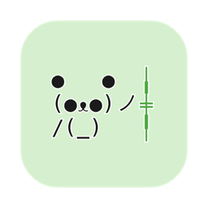

<p align="center">
  
</p>

# PandaPal

A coding companion for your Mac. Bao, a tiny text-art panda, tells you in one short line when Claude Code, Codex or opencode need you, and keeps you company while they work. Between runs it is a sweet distraction that reminds you to rest your eyes, move, drink water and go to bed.

<p align="center">
  <picture>
    <source media="(prefers-color-scheme: dark)" srcset="docs/poses-dark.png">
    
  </picture>
</p>

- **Tells you when your agents need you.** A permission prompt, a question, or finished work, with the session's name: "stocks · Run stopped before writing anything." Connect your agents from Bao's menu.
- **Quiet until it matters.** A small model reads each finished turn, and Bao speaks only when you are needed. A message wakes Bao from a nap, and during calls it goes to a notification instead.
- **Looks after you, gently.** Eye rests, breaks, water, daylight and bedtime, with 13 break ideas that Bao acts out. It asks at most twice an hour, never while you type, and stays quiet during calls.
- **Has a personality.** Pet it, tickle it, wave at it, drag it around. It giggles, dances, gets dizzy, sulks and forgives, and it has a mood each day.
- **Breathes with you.** A one-minute breathing exercise from its menu.
- **Says what your scripts tell it.** `PandaPal --say "Tests passed!"` and Bao jumps up and says it.
- **Rewards care, not screen time.** Bond, tricks and gifts come from breaks. Videos and calls do not count as breaks.
- **Private and light.** Bao has no AI and no network of its own, and no account. About 0.14% CPU and 32 MB of memory, measured.

## Setup

PandaPal needs macOS 26 or later on Apple silicon. Get it one of two ways, then connect your coding agents.

### Option 1: download

1. Download the `PandaPal` zip from [the latest release](https://github.com/luffy2095/pandapal/releases/latest).
2. Unzip it and move `PandaPal.app` to your Applications folder.
3. Open it. PandaPal is free and not notarized by Apple, so macOS blocks the first open. Open System Settings, then Privacy & Security, scroll down, and click "Open Anyway" next to PandaPal. Or run this once in Terminal:

```sh
xattr -dr com.apple.quarantine /Applications/PandaPal.app
```

### Option 2: build from source

Needs the Xcode command line tools with the macOS 26 SDK or newer (Swift 6.2+). Quit PandaPal first if it runs.

```sh
git clone https://github.com/luffy2095/pandapal.git
cd pandapal
./build.sh                      # runs the behaviour tests, then builds build/PandaPal.app
ditto build/PandaPal.app /Applications/PandaPal.app
open /Applications/PandaPal.app
```

An app you build yourself opens without the "Open Anyway" step. Run it from Applications, not from `build/`: each build deletes `build/PandaPal.app` first, and the agents' hooks would stop working meanwhile. It builds with `swiftc` directly, not the Swift package manager, because the package manager in Command Line Tools 27.0 cannot build manifests on this Mac.

### Then: connect your coding agents

Bao appears at the bottom right of your screen. Right-click it, or click 🐼 in the menu bar, for the menu, and choose **Connect coding agents…** ([more below](#coding-agents)). To start PandaPal at login: System Settings, General, Login Items, then add PandaPal.

<p align="center">
  <picture>
    <source media="(prefers-color-scheme: dark)" srcset="docs/tide-dark.gif">
    
  </picture>
  <br>
  <sub>Wave your pointer side to side over Bao, and it does the tide dance.</sub>
</p>

## Using it

- **Click** Bao to pet it.
- **Drag** it anywhere. It remembers the spot, and if that spot ends up off every screen, it comes back to the bottom right.
- **Tap, double-tap, tap fast, press and hold, drag, shake, tickle or wave** for its personality. The table under "Personality" lists every reaction.
- **Click** one of its speech bubbles to put it away.
- **The menu** shows today's screen time, breaks and eye rests, your bond and the next unlock, the gifts found and today's mood. It also has: pet the panda, breathe with Bao for a minute, snooze break reminders for an hour, hide the panda, size (small, normal or large), and quit.

## How it behaves

It shows your needs as its own, and it never rewards screen time.

| Your need | When | The panda | Met by |
|---|---|---|---|
| Eye rest | every 20 minutes of screen time | gazes into the distance | looking away for 20 seconds |
| Movement | after 50 minutes without a break | asks for a break, slowly (below) | a break of 5 minutes or more |
| Water | about every 90 minutes | sips tea | a break |
| Daylight | once, between 12:00 and 15:00 | waves at the sun | a break of 15 minutes or more around midday |
| Wind-down | from 23:00 | yawns and gets sleepy | locking the screen |

**How it asks for a break.** It escalates slowly and steps back as soon as you take one:

1. At your next natural pause, 15 to 60 seconds without typing, it looks at you and stretches. No bubble.
2. Ten minutes later it waves and says a break idea in its bubble, and the menu has it too.
3. Twenty minutes after that it sends one macOS notification. Then it stops asking.

It asks at most twice an hour, never interrupts while you type, and "Snooze break reminders for 1 hour" in its menu silences it for meetings.

**Break ideas.** Bao suggests one of 13 and acts it out while it waits: stretch, look far away, drink water, step into daylight, roll your shoulders, tilt your head, shake out your wrists, rest your eyes under your palms, blink slowly, take a short walk, breathe, reach up high, or have a snack. Water comes first when it is due, and daylight only between 8:00 and 18:00.

**Calls and videos.** While some app uses the camera or records the microphone, you are probably on a call. Bao stays quiet then: none of its own lines, no break asks, no notifications, and no idle quirks, in case you share your screen. Words from your scripts still show. While a video plays, macOS keeps the display awake. Bao reads both, so a call or a video counts as screen time, not as a break or an eye rest, even when you do not type. Some tools, such as `caffeinate`, keep the display awake all day, so after 45 minutes without a key or a click, Bao assumes you have left.

**Breathe with Bao.** Choose "Breathe with Bao (1 minute)" in the menu. Bao closes its eyes. As you breathe in for 4 seconds, its arms rise, its chest fills and air drifts to its nose. As you hold for 4, it stays still with its arms up. As you breathe out for 4, its mouth opens, its arms come down and a puff drifts out. "in", "hold" and "out" show beside it and gain a dot each second, to count by. After five breaths it is happy with you. A tap ends it early.

**On dark screens** Bao and its cloud have a soft glow, so they stand apart from white text on a dark code screen.

**Its own words.** After you come back from a break, when it asks for one, on your first visit in the morning (in its mood of the day), late at night, after days away, when it finds a gift, and when it learns a trick, Bao says a short line in its bubble. The lines are written by hand, and each moment picks one at random. At most four lines an hour. Bao learns from you: a line you click, or answer with a pet, keeps it chatty, and each line you ignore makes the next one less likely, down to one time in four. Its eye-rest nudge learns the same way, from every 5 minutes up to every 20 if you ignore it. Break asks and bedtime lines never come less often.

**Bond.** It grows from care: each break, every third eye rest, and locking the screen during the wind-down hour. There are no streaks, the bond never drops, and higher bond unlocks behaviour, not points:

- From bond 10 it runs to greet you after every break.
- From bond 25 it also shows off a roll.
- Then a new trick or gift at bond 40, 50, 65, 80, 100, 125 and 160. Bao shows off each new trick the moment it learns it. The menu shows when the next unlock comes, but not what it is.

**Surprises.** You never know what comes, which keeps them fun:

- After each break and each eye rest that was due, once you are back: a trick it knows, a heart (one more bond) one time in four, or a gift one time in ten. A gift sits beside Bao for the rest of the day `✿`, and the menu counts the gifts you have found. Newer gifts are rarer.
- Play brings surprises too. A pet, hug, high five, giggle or dance brings a trick or a heart one time in four, at most 3 a day and 30 minutes apart, and never a gift. Gifts stay the reward for care, so play is a moment of fun and never a reason to stay at the screen.

**Everyday life.** While you work it munches bamboo, blinks, and glances toward your pointer. Now and then it sneezes a little spray, hiccups, drops its bamboo, blows a bubble that pops, watches a bamboo leaf drift down, or gets a visit from a butterfly that rests between its ears. It never does these while it asks for a break, while you focus, or during a call. After 25 minutes of focus it puts its bamboo down and sleeps on its side, so only its z's move while you work. While you are away it yawns, lies down on its side and naps, with growing z's. After two days or more away it greets you with a big reunion.

**Mood of the day.** Each morning Bao picks a mood from how your last day went: curious on its first day; sleepy or grumpy after a late night or long stretches without a break; playful or cuddly after a day with plenty of breaks. It never repeats yesterday's mood when another fits. The mood tunes its rules (grumpy goes shy after 8 taps instead of 12 and pouts sooner, playful giggles at a double tap, cuddly hugs when tapped, curious notices your pointer more often, sleepy ignores it), a third of its idle moments show it, and it says good morning in it. The menu shows today's mood.

**Personality.** It is curious, ticklish, a bit shy, sassy when pestered, a grump when woken, and quick to forgive.

| You do | It does |
|---|---|
| tap | a pet: squish, and one big heart and a few small ones float up |
| double tap | high five `(●ᴥ●)ノ☆` with a burst of sparkles |
| 3 quick taps | giggles `(≧ᴥ≦)`, with a different laugh each time: hehe, haha, teehee… |
| 8 taps in a few seconds | gets dizzy `(@ᴥ@)`, with stars circling its head |
| 12 taps in a minute | goes shy `(⁄ᴥ⁄)` for 10 seconds |
| keep tapping while it is shy | gets cutely angry `(ÒᴥÓ) ╬`, puffs steam from its ears, and stomps until you stop |
| tap when its patience is low | pouts `(¬ᴥ¬) hmph` |
| press and hold | a hug `⊂(ᵔᴥᵔ)⊃` with floating hearts, which restores its patience |
| drag | dangles `\(°ᴥ°)/ wheee`; shake it and it is dizzy when dropped |
| pointer comes near | notices you `(◐ᴥ◐) ?` |
| swipe the pointer fast up and down over it | a tickle: giggles `(≧ᴥ≦)` with one of its laughs |
| wave the pointer side to side over it | does the tide dance: its arms flow `~(ᵔᴥᵔ~)` `\(ᵔᴥᵔ)/` `(~ᵔᴥᵔ)~` while it sways and notes float up |
| tap while it naps | one eye opens `(-ᴥ•)`; 3 quick taps wake it |
| tap while it wants a break | cheers you on `\(●ᴥ●)/ go!` |

Play earns bond only through its capped surprises. Its patience refills within a couple of minutes.

## Coding agents

Choose **Connect coding agents…** from Bao's menu. Bao finds Claude Code (in the terminal and in the Claude app), Codex and opencode, asks which model writes its short lines, and adds its hooks to each agent's settings. In Codex, type `/hooks` once and trust Bao's two hooks. **Disconnect** in the same window takes them out again.

Then Bao jumps up with a "!" and says:

- **A permission prompt or a question**, in the agent's own words: "D2D · Claude needs your permission to use Bash".
- **Finished work, a decision for you, or a failure**, in one short line that a small model writes from the agent's last reply: "stocks · Run stopped before writing anything; schedule still active." When the turn needs nothing from you, Bao stays quiet.

The line starts with the session's name: the one you gave it with `/rename`, else the agent's own title, else the folder. If Bao naps or dozes when a message comes, it wakes up, and its sleep timer starts over.

| Model for short lines | How | Time, measured |
|---|---|---|
| Each agent's own model (default) | Claude Haiku for Claude Code, GPT-5.6 Luna for Codex | 2.2 to 3.7 s, 4.6 to 11.0 s |
| Claude Haiku | `claude -p`, with no tools, MCP servers, hooks, CLAUDE.md or saved session | 2.2 to 3.7 s, about 800 tokens |
| GPT-5.6 Luna | `codex exec`, read-only and not saved | 4.6 to 11.0 s |
| Gemini Flash | `gemini -p`; never opens a login page | not measured |
| None | Only prompts and questions; finished turns stay on your Mac | |

Each line runs in the background, so an agent never waits for Bao, and a call stops after 60 seconds. It uses your own agent's login and plan: a Claude Haiku line cost $0.00015 to $0.00026 at API prices, measured.

## Make Bao say things

Any script can hand Bao the words to say:

```sh
/Applications/PandaPal.app/Contents/MacOS/PandaPal --say "Tests passed!"
```

Bao jumps up and says it in its bubble. The bubble goes 15 seconds after you are at your Mac: at once if you are using it, or, if you were away, 15 seconds after you move the mouse or type. A click puts it away sooner. When nobody can see Bao (it is hidden, a full-screen app covers it, or the screen is locked) or you are in a call, a macOS notification titled "Bao says" carries the words instead. macOS keeps notifications off a shared screen. Bao says the words exactly as given, on one line, up to 200 characters, and saves nothing. The words go straight to Bao: other apps cannot listen in, and sandboxed apps cannot send any. The command exits with 0 when the words were sent, 1 when PandaPal is not running, and 2 when there is nothing to say.

For example, with an alias in your shell profile:

```sh
alias bao='/Applications/PandaPal.app/Contents/MacOS/PandaPal --say'
make test && bao "Tests passed!" || bao "Tests failed. Hmph."
```

## Privacy

- It reads: whether the screen is locked or asleep, how many seconds since the last key or mouse event, and the clock. It also reads whether some app is using a camera or recording a microphone, and whether some app keeps the display awake. macOS answers each of these with only on or off, with no permission and nothing about who you talk to or what you watch. During its moments it reads where the pointer is, to glance that way, and keeps nothing. It never sees what you type, which app you use, or what is on screen.
- It needs no permissions, makes no network connections, and has no AI of its own.
- When you connect coding agents, a finished turn's last reply goes to the model you chose, through that agent's own command-line tool, to write Bao's short line. By default that is the company that wrote the reply. Choose None to keep finished turns on your Mac. Connecting changes only Bao's own entries in each agent's settings, keeps the file private, and saves a backup copy beside it first.
- The only permission it may ask for is notifications, once, the first time it sends its break notification or shows words from a script while nobody can see it.
- It saves one small file, `~/Library/Application Support/PandaPal/memory.json`: bond, today's date, today's breaks and eye rests, longest stretch today, which daily moments already happened, when it last saw you, the same counts for your last day, today's mood, how many of each gift it found, today's gift and play surprises, and two numbers for how often you answer its lines and eye-rest nudges. Its size and spot on screen are kept in its preferences.

## Saving power

- Animations play in short moments, then the panda holds still, which costs nothing. Effects such as hearts and sparkles run in Core Animation and remove themselves when they end.
- Everything pauses while the panda is covered, hidden, or the screen is locked.
- Its checks for calls and videos take 0.073 ms and 0.116 ms, once every 15 seconds. Run alone for 3 minutes, they used 0.032% CPU, start-up included.

Measured on macOS 27, Apple silicon, with the full behaviour engine ticking every 15 seconds:

| What | Result | Date |
|---|---|---|
| CPU, panda visible, after it warmed up, 3-minute average | 0.144% | 2026-10-27 |
| Memory footprint, just after launch | 16 MB | 2026-10-27 |
| Memory footprint, once its frames are drawn and kept | 32 MB | 2026-10-27 |
| App size, with its icon | 600 KB | 2026-10-27 |

The window compositor's share is not measured yet. It needs `powermetrics` on an otherwise idle screen.

## How it is made

The panda needs no art files. Each frame is three lines of Menlo, drawn to an image the first time it is needed; the sleeping frames are the upright panda turned on its side. The frames live in `Sources/PandaPal/TextPandaView.swift`.

- `Sources/PandaPal/Brain.swift`: needs, the break escalation, bond, surprises and daily rhythm, with no UI, so a test can run a whole day with made-up times.
- `Sources/PandaPal/Personality.swift`: how it reacts to taps, holds, drags, tickles, waves and hovers, and its mood of the day.
- `Sources/PandaPal/Rewards.swift`: the surprises, their odds, and what each bond level unlocks.
- `Sources/PandaPal/Words.swift`: Bao's hand-written lines and break ideas, and the tidying of words from `--say`.
- `Sources/PandaPal/Presence.swift`: the on-or-off checks for calls and videos.
- `Sources/PandaPal/Bubbles.swift`: the speech bubble.
- `Sources/PandaPal/PandaShell.swift`: the panda's mouse handling: petting, dragging, tickles, waves, hover and the menu.
- `Sources/PandaPal/TextPandaView.swift`: the panda, its frames, its effects and its breathing.
- `Sources/PandaPal/main.swift`: the menu bar, the floating window, system events, `--say`, `--hook`, and the saved file.
- `Sources/PandaPal/Agents.swift`: "Connect coding agents…": adds and removes Bao's hooks in each agent's settings.
- `Resources/hook.sh`: the hook the agents run through `PandaPal --hook`. It names the session and asks the chosen model for a short line.
- `Tests/main.swift`: the behaviour, personality, reward and word tests, run by `build.sh`.
- `Resources/AppIcon.icns`: the app icon, made from `docs/icon.png`.
- `./build/PandaPal.app/Contents/MacOS/PandaPal --snapshot <dir>` renders every frame and each gift to PNG, to check the art without a screen.

## License

PandaPal is free software under the [GNU General Public License v3.0](LICENSE).
