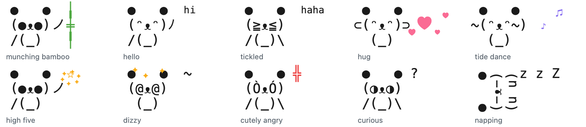
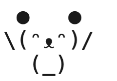

# PandaPal

A tiny text-art panda that lives on your Mac's screen. Bao keeps you company on long screen days, and it reminds you to rest your eyes, move, drink water and go to bed, by showing those needs as its own. Everything runs on your Mac.

<p align="center">
  <picture>
    <source media="(prefers-color-scheme: dark)" srcset="docs/poses-dark.png">
    
  </picture>
</p>

- **Looks after you, gently.** Eye rests, breaks, water, daylight and bedtime. It asks at most twice an hour, and never while you type.
- **Has a personality.** Pet it, tickle it, wave at it, drag it around. It giggles, dances, gets dizzy, sulks and forgives, and it has a mood each day.
- **Talks.** Chat with Bao through Apple's on-device model. It sets reminders and focus sessions for you.
- **Rewards care, not screen time.** Bond, tricks and gifts come from breaks. Play has a small daily cap.
- **Private and light.** No network, no account, one small file. About 0.06% CPU and 15 MB of memory, measured.

## Quick start

Needs macOS 26 or later and the Xcode command line tools. The chat also needs Apple Intelligence.

```sh
git clone https://github.com/luffy2095/pandapal.git
cd pandapal
./build.sh
open build/PandaPal.app
```

Bao appears at the bottom right of your screen. Hover over it and click "talk?", or right-click it for the menu.

<p align="center">
  <picture>
    <source media="(prefers-color-scheme: dark)" srcset="docs/tide-dark.gif">
    
  </picture>
  <br>
  <sub>Wave your pointer side to side over Bao, and it does the tide dance.</sub>
</p>

## Using it

- **Click** Bao to pet it.
- **Drag** it anywhere. It remembers the spot.
- **Tap, double-tap, tap fast, press and hold, drag, shake, tickle or wave** for its personality. The table under "Personality" lists every reaction.
- **Hover** over it and click "talk?" to chat.
- **Right-click** it, or click 🐼 in the menu bar, for the menu: talk to Bao, today's screen time, breaks and eye rests, bond and the next unlock, gifts found, today's mood, snooze break reminders for an hour, hide the panda, and quit.

## How it behaves

It shows your needs as its own, and it never rewards screen time.

| Your need | When | The panda | Met by |
|---|---|---|---|
| Eye rest | every 20 minutes of screen time | gazes into the distance | looking away for 20 seconds |
| Movement | after 50 minutes without a break | asks for a break, slowly (below) | a break of 5 minutes or more |
| Water | about every 90 minutes | sips tea | a break |
| Daylight | once, between 12:00 and 15:00 | waves at the sun | a break of 15 minutes or more around midday |
| Wind-down | from 23:00 | yawns and gets sleepy | locking the screen |

**How it asks for a break.** It escalates slowly and steps back as soon as you take one:

1. At your next natural pause, 15 to 60 seconds without typing, it looks at you and stretches. No bubble.
2. Ten minutes later it waves with a "break?" bubble, and the menu has a suggestion.
3. Twenty minutes after that it sends one macOS notification. Then it stops asking.

It asks at most twice an hour, never interrupts while you type, and "Snooze break reminders for 1 hour" in its menu silences it for meetings.

**Bond.** It grows from care: each break, every third eye rest, and locking the screen during the wind-down hour. There are no streaks, the bond never drops, and higher bond unlocks behaviour, not points:

- From bond 10 it runs to greet you after every break.
- From bond 25 it also shows off a roll.
- Then a new trick or gift at bond 40, 50, 65, 80, 100, 125 and 160. Bao shows off each new trick the moment it learns it. The menu shows when the next unlock comes, but not what it is.

**Surprises.** You never know what comes, which keeps them fun:

- After each break and each eye rest that was due, once you are back: a trick it knows, a heart (one more bond) one time in four, or a gift one time in ten. A gift sits beside Bao for the rest of the day `✿`, and the menu counts the gifts you have found. Newer gifts are rarer.
- Play brings surprises too. A pet, hug, high five, giggle, dance or chat brings a trick or a heart one time in four, at most 3 a day and 30 minutes apart, and never a gift. Gifts stay the reward for care, so play is a moment of fun and never a reason to stay at the screen.

**Everyday life.** While you work it munches bamboo, blinks, and glances toward your pointer. Now and then it sneezes a little spray, hiccups, drops its bamboo, blows a bubble that pops, watches a bamboo leaf drift down, or gets a visit from a butterfly that rests between its ears. It never does these while it asks for a break or while you focus. After 25 minutes of focus it puts its bamboo down and sleeps on its side, so only its z's move while you work. It says good morning on your first visit before noon. While you are away it yawns, lies down on its side and naps, with growing z's. After two days or more away it greets you with a big reunion.

**Mood of the day.** Each morning Bao picks a mood from how your last day went: curious on its first day; sleepy or grumpy after a late night or long stretches without a break; playful or cuddly after a day with plenty of breaks. It never repeats yesterday's mood when another fits. The mood tunes its rules (grumpy goes shy after 8 taps instead of 12 and pouts sooner, playful giggles at a double tap, cuddly hugs when tapped, curious notices your pointer more often, sleepy ignores it), a third of its idle moments show it, and its words carry it. A rule picks the mood, not the model: asked to choose, Apple's model contradicted the facts in 6 of 8 tries. The menu shows today's mood.

**Personality.** It is curious, ticklish, a bit shy, sassy when pestered, a grump when woken, and quick to forgive.

| You do | It does |
|---|---|
| tap | a pet: squish, and one big heart and a few small ones float up |
| double tap | high five `(●ᴥ●)ノ☆` with a burst of sparkles |
| 3 quick taps | giggles `(≧ᴥ≦)`, with a different laugh each time: hehe, haha, teehee… |
| 8 taps in a few seconds | gets dizzy `(@ᴥ@)`, with stars circling its head |
| 12 taps in a minute | goes shy `(⁄ᴥ⁄)` for 10 seconds |
| keep tapping while it is shy | gets cutely angry `(ÒᴥÓ) ╬`, puffs steam from its ears, and stomps until you stop |
| tap when its patience is low | pouts `(¬ᴥ¬) hmph` |
| press and hold | a hug `⊂(ᵔᴥᵔ)⊃` with floating hearts, which restores its patience |
| drag | dangles `\(°ᴥ°)/ wheee`; shake it and it is dizzy when dropped |
| pointer comes near | notices you `(◐ᴥ◐) ?` |
| swipe the pointer fast up and down over it | a tickle: giggles `(≧ᴥ≦)` with one of its laughs |
| wave the pointer side to side over it | does the tide dance: its arms flow `~(ᵔᴥᵔ~)` `\(ᵔᴥᵔ)/` `(~ᵔᴥᵔ)~` while it sways and notes float up |
| tap while it naps | one eye opens `(-ᴥ•)`; 3 quick taps wake it |
| tap while it wants a break | cheers you on `\(●ᴥ●)/ go!` |

Play earns bond only through its capped surprises. Its patience refills within a couple of minutes. While Bao plays a moment, the "talk?" bubble steps aside, and it comes back afterwards if your pointer is still there.

## Talk to it

Bao talks through Apple's on-device model. It runs entirely on your Mac, with no network, no account and no API key. It needs Apple Intelligence switched on.

- **Chat:** move the pointer over the panda and click the "talk?" bubble above its head. The bubble goes as soon as the pointer leaves the panda and the bubble. You can also click one of its own lines to answer it, or choose "Talk to Bao…" in the menu. Replies type out while its mouth moves. A click outside the chat closes it, unless Bao is still answering. Closing the chat ends the conversation, and nothing is saved.
- **What it can do:** ask it anything, and it answers from what the model knows. It can also set a reminder ("remind me to call mom at 7"), start a focus session ("I need to focus for 45 minutes"), pause its break reminders ("stop bugging me for an hour"), tell you how your day is going, tell you the time and date, and open the Weather app. Bao delivers reminders herself: at the time, she waves and says it in her bubble, which stays until you click it, and the end of a focus session works the same way. If nobody can see her then (the panda is hidden, a full-screen app covers it, or the screen is locked), a macOS notification carries the reminder instead, so none is missed. Reminders wait in the saved file, so a restart keeps them; if PandaPal is not running at the time, she says it when it next starts. Each action shows a ✓ line under the reply that says exactly what was done and when, or a ✗ line if it could not be done. It cannot look up live things such as weather, news or prices, because it runs offline.
- **Speed:** each message is one call to the model. Bao's actions are tools the model calls by itself during that call, at most one per reply. The chat window is prepared when the "talk?" bubble appears, so it opens at once. The model starts loading when you open the chat, so the first reply is the slowest. When your Mac is very low on memory, macOS pauses the model, and Bao says so.
- **Its own words:** after you come back from a break, when it asks for one, on your first visit in the morning, and late at night, it says a short line in a speech bubble. At most four an hour, and never while the chat is open. Bao learns from you: a line you click, or answer with a pet, keeps it chatty, and each line you ignore makes the next one less likely, down to one time in four. Its eye-rest nudge learns the same way, from every 5 minutes up to every 20 if you ignore it. Break asks and bedtime lines never come less often.
- **What it knows:** what you type in the open chat, plus, only when you ask, the time and date, and your screen time since the last break, today's breaks and eye rests, and your longest stretch today. It cannot see your screen, apps or files.
- **How it speaks:** in the chat, usually one to three short sentences. In its bubble, one short line. Each ends with exactly one face that the app chooses from its mood. It is a friend, not a therapist.
- **Test it from the terminal:** `open -n -W --stdout out.txt build/PandaPal.app --args --ask "hi" "remind me to stretch in 10 minutes"` asks each message in one chat and prints the replies, their timing and any action, without doing the action. `--ask --moment "The user just came back from a break."` asks for a bubble line. It goes through `open` because macOS lets apps use the model, and a plain terminal process may be refused.

## Privacy

- It reads three things: whether the screen is locked or asleep, how many seconds since the last key or mouse event, and the clock. During its moments it also reads where the pointer is, to glance that way, and keeps nothing. It never sees what you type outside its chat, which app you use, or what is on screen.
- It needs no permissions and makes no network connections. Bao's words come from Apple's on-device model, so they are generated on this Mac too. Chats are kept in memory only while the chat is open.
- The only permission it may ask for is notifications, once, the first time it sends its break notification or a reminder you asked for.
- It saves one small file, `~/Library/Application Support/PandaPal/memory.json`: bond, today's date, today's breaks and eye rests, longest stretch today, which daily moments already happened, when it last saw you, the same counts for your last day, today's mood, any reminders you asked for (each deleted once Bao says it), how many of each gift it found, today's gift and play surprises, and two numbers for how often you answer its lines and eye-rest nudges.

## Saving power

- Animations play in short moments, then the panda holds still, which costs nothing. Effects such as hearts and sparkles run in Core Animation and remove themselves when they end.
- Everything pauses while the panda is covered, hidden, or the screen is locked.

Measured on macOS 27, Apple silicon, with the full behaviour engine ticking every 15 seconds:

| What | Result | Date |
|---|---|---|
| CPU, panda visible and working, 3-minute average | 0.056% | 2026-10-26 |
| Memory footprint, one minute after launch | 15 MB | 2026-10-27 |
| App size | 604 KB | 2026-10-27 |

The window compositor's share is not measured yet. It needs `powermetrics` on an otherwise idle screen. The chat uses Apple's model service, which macOS shares between all Apple Intelligence features.

## Build details

It builds with `swiftc` directly, not the Swift package manager, because the package manager in Command Line Tools 27.0 cannot build manifests on this Mac. It needs the macOS 26 SDK or newer (Swift 6.2+). `./build.sh` runs the behaviour tests first, then builds `build/PandaPal.app`.

To start PandaPal at login: System Settings, General, Login Items, then add `build/PandaPal.app`.

## How it is made

The panda needs no art files. Each frame is three lines of Menlo, drawn to an image the first time it is needed; the sleeping frames are the upright panda turned on its side. The frames live in `Sources/PandaPal/TextPandaView.swift`.

- `Sources/PandaPal/Brain.swift`: needs, the break escalation, bond, surprises and daily rhythm, with no UI, so a test can run a whole day with made-up times.
- `Sources/PandaPal/Personality.swift`: how it reacts to taps, holds, drags, tickles, waves and hovers, and its mood of the day.
- `Sources/PandaPal/Rewards.swift`: the surprises, their odds, and what each bond level unlocks.
- `Sources/PandaPal/Companion.swift`: Bao's voice from Apple's on-device model, and its tools.
- `Sources/PandaPal/Bubbles.swift`: the speech-bubble shape, and the talk invite, Bao's lines and the chat that use it.
- `Sources/PandaPal/PandaShell.swift`: the panda's mouse handling: petting, dragging, tickles, waves, hover and the menu.
- `Sources/PandaPal/TextPandaView.swift`: the panda, its frames and its effects.
- `Sources/PandaPal/main.swift`: the menu bar, the floating window, system events and the saved file.
- `Tests/main.swift`: the behaviour, personality and reward tests, run by `build.sh`.
- `./build/PandaPal.app/Contents/MacOS/PandaPal --snapshot <dir>` renders every frame and each gift to PNG, to check the art without a screen.

## License

PandaPal is free software under the [GNU General Public License v3.0](LICENSE).
